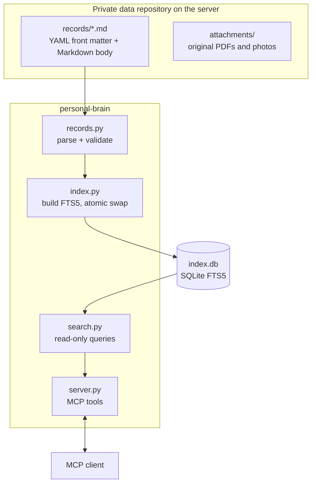
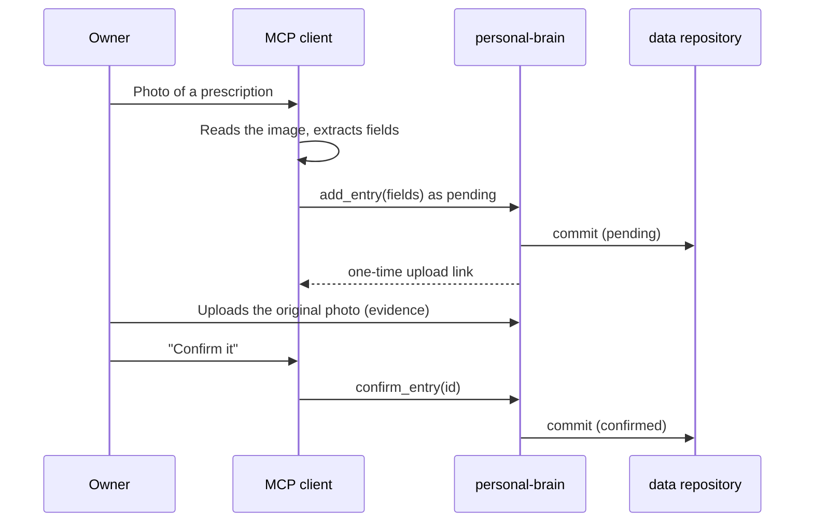

# Architecture

This document explains how Personal Brain is built and why. Each decision links to its ADR in [docs/adr](docs/adr/).

## Goals and constraints

- **Trust over reach.** For health records, a sourced "I don't know" beats a fluent guess. Every answer must be verifiable.
- **Single user, self-hosted.** One person, one server. No multi-tenancy, no SaaS.
- **Works with the computer off.** The phone must be able to query the memory; no laptop in the loop.
- **Small operational surface.** It runs next to other services on a small VPS, under an existing backup and monitoring setup. No extra database server.
- **Public code, private data.** The repository is a portfolio piece; the data is not ([ADR 009](docs/adr/009-public-code-private-data.md)).

## Components



| Component | Responsibility | Decision |
|---|---|---|
| Data repository | Source of truth. Every change is a commit: history, audit trail and revert for free. | [ADR 002](docs/adr/002-git-repository-as-source-of-truth.md) |
| `records.py` | Parses Markdown + YAML records and rejects anything invalid before it reaches the index. | [ADR 004](docs/adr/004-markdown-yaml-records.md) |
| `index.py` | Builds a fresh SQLite FTS5 index and swaps it in atomically. | [ADR 003](docs/adr/003-sqlite-fts5-index.md) |
| `search.py` | Read-only queries. User input is tokenized and quoted, so it can never be FTS5 syntax. | [ADR 003](docs/adr/003-sqlite-fts5-index.md) |
| `server.py` | Exposes `search` and `read_entry` over MCP. | [ADR 001](docs/adr/001-python-and-official-mcp-sdk.md), [ADR 006](docs/adr/006-read-only-tools-first.md) |

## Record model

```yaml
---
id: rx-2026-03-12-moisturizer     # stable, opaque, unique
event_type: prescription          # encounter | exam | prescription | medication_use | follow_up
date: 2026-03-12                  # YYYY, YYYY-MM or YYYY-MM-DD: precision is preserved
review_status: confirmed          # pending | confirmed
title: "Prescription: fragrance-free moisturizer"
---
Free Markdown body.
```

Two rules carry most of the domain safety:

1. **`review_status`.** Data written by an AI enters as `pending`. Only the owner moves it to `confirmed` ([ADR 005](docs/adr/005-pending-before-confirmed.md)).
2. **`prescription` vs `medication_use`.** Being prescribed something is not evidence of taking it. They are separate records linked by id.

## Flows

### Query (phases 1–3)

```mermaid
sequenceDiagram
    participant U as Owner
    participant C as MCP client
    participant S as personal-brain
    participant I as index.db
    U->>C: "When was my last blood test?"
    C->>S: search("blood test")
    S->>I: FTS5 MATCH (read-only connection)
    I-->>S: rows ranked by bm25
    S-->>C: id, date, review_status, snippet, source, sha256
    C->>S: read_entry("exam-2026-04-02-blood")
    S-->>C: full record
    C-->>U: Answer citing the source; pending records flagged as unconfirmed
```

### Rebuild

A rebuild loads and validates every record first. If any record is invalid, nothing is written and the current index keeps serving. On success, the new index is written to a temporary file and moved over the old one with `os.replace`, which is atomic on the same filesystem.

### Capture (phase 4, planned)



## Security and privacy

| Threat | Mitigation |
|---|---|
| Unauthenticated access to health data | No public exposure before OAuth. Until then, access only through an SSH tunnel or a private network ([ADR 008](docs/adr/008-tunnel-before-oauth.md)). |
| Sensitive terms leaking through logs or URLs | No logging of queries or record content. MCP tool arguments travel in the request body, never in a URL ([ADR 007](docs/adr/007-no-content-in-logs.md)). |
| Query injection into FTS5 | Every user token is quoted; operators in input are treated as text. Covered by tests. |
| Accidental writes through the query path | The query layer opens SQLite in read-only mode. Covered by tests. |
| AI hallucinations stored as facts | `pending` status, flagged in every result and in tool descriptions ([ADR 005](docs/adr/005-pending-before-confirmed.md)). |
| Data loss | Git history plus an encrypted off-site backup. A restore drill must pass before real data is migrated. |
| Real data reaching the public repository | Real data never lives here; `.gitignore` blocks data files and CI runs a secret scan on every push ([ADR 009](docs/adr/009-public-code-private-data.md)). |

A known trade-off: when an MCP client uses a record to answer, the retrieved text is sent to that client's model provider. This is accepted by the owner and is the reason the service returns snippets and single records, never bulk exports.

## Evaluation (phase 2)

A fixed set of questions, each with its expected record. Metrics:

- retrieval (expected record in the top 5);
- faithfulness of the answer;
- correct handling of pending and missing data;
- presence of the citation;
- scope violations.

The real question set stays private; a fictional twin runs in CI. Semantic search (embeddings) is only added if the evaluation shows a failure that full-text search can't fix.
