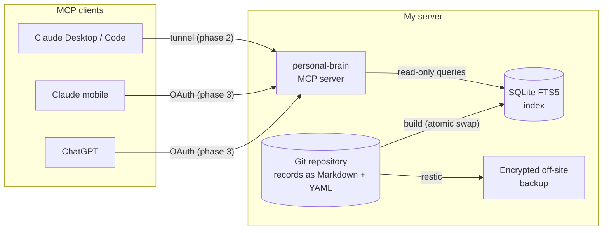

# Personal Brain

**A personal memory MCP server where every answer cites its source.**

My AI assistants (Claude, ChatGPT and others) don't share a trusted memory, and when they answer from my notes they rarely say where the answer came from. Personal Brain is a small, self-hosted service that gives any MCP client read access to my personal records. Every result carries the record id, its source file, a content hash and a review status, so the assistant can cite it and I can verify it.

The first domain is **health records**: consultations, exams, prescriptions, medication use and follow-ups. It's a domain where a wrong or invented answer is worse than no answer. Other domains, such as training methodology, live side by side, and each client only sees the domains it was granted ([ADR 011](docs/adr/011-domains-and-scopes.md)).

[](https://github.com/adayanecoutinho/personal-brain/actions/workflows/ci.yml)

> **Status:** early development (phase 1 of 4). This repository contains code and **fictional data only**. Real records live in a private Git repository on my own server and never touch GitHub ([ADR 009](docs/adr/009-public-code-private-data.md)).

## What makes it different

- **Sourced answers.** Every search result returns `source` and `sha256`. The tool description instructs the client to cite them.
- **Pending is not a fact.** Anything an AI extracts (say, from a photo of a prescription) is stored as `pending` until I confirm it. Pending records are flagged on every result ([ADR 005](docs/adr/005-pending-before-confirmed.md)).
- **Prescribed is not taken.** A prescription and the actual medication use are separate records ([ADR 004](docs/adr/004-markdown-yaml-records.md)).
- **No invented dates.** A record dated `2026-03` keeps month precision; nothing fills in a day.
- **Least privilege per client.** Records are grouped by domain (`health`, `training`, ...). A client scoped to `training` never sees health records, not even whether they exist ([ADR 011](docs/adr/011-domains-and-scopes.md)).
- **Read-only first, private by default.** Two read tools only, a read-only database connection, and no record content or query terms in logs ([ADR 006](docs/adr/006-read-only-tools-first.md), [ADR 007](docs/adr/007-no-content-in-logs.md)).

## Architecture



The Git repository is the source of truth. The index is derived: it can be deleted and rebuilt from the records at any time. Details in [ARCHITECTURE.md](ARCHITECTURE.md).

## Quick start

Requires Python 3.12+ and [uv](https://docs.astral.sh/uv/).

```sh
uv sync
uv run personal-brain build --records examples/records --db data/index.db
uv run personal-brain search --db data/index.db "moisturizer"
uv run pytest
```

Connect it to Claude Desktop (stdio) by adding to `claude_desktop_config.json`:

```json
{
  "mcpServers": {
    "personal-brain": {
      "command": "uv",
      "args": ["--directory", "/path/to/personal-brain", "run", "personal-brain", "serve", "--db", "data/index.db"]
    }
  }
}
```

### Run as a container (server deployment)

```sh
docker build -t personal-brain .
docker run -d --name personal-brain -p 127.0.0.1:8000:8000 \
  -v "$PWD/examples/records:/data/records:ro" personal-brain
# MCP endpoint: http://127.0.0.1:8000/mcp  ·  health: http://127.0.0.1:8000/health
```

Records are mounted read-only and the index is rebuilt at start ([ADR 010](docs/adr/010-container-deployment.md)).

### Check that queries never reach the logs

```sh
uv run personal-brain check-logs --url http://127.0.0.1:8000/mcp --logs-command "docker logs personal-brain"
```

It sends random canary terms through `search` and `read_entry`, then fails if any of them appears in the logs. CI runs it against the built image on every push ([ADR 007](docs/adr/007-no-content-in-logs.md)).

## Tools

| Tool | Purpose | Returns |
|---|---|---|
| `search(query, limit=5, domain=None)` | Full-text search within the caller's scope, optionally narrowed to one domain | `id`, `domain`, `event_type`, `date`, `review_status`, `title`, `snippet`, `source`, `sha256` |
| `read_entry(id)` | Read one full record | All fields plus `body` |

## Roadmap

| Phase | Scope | Exit criterion |
|---|---|---|
| 1 | Record format, index, read tools, tests, CI; data repository and off-site backup on the server, restore proven | Restore from off-site backup in an isolated environment passes before any real data is migrated |
| 2 | Read access from Claude Desktop through a tunnel; evaluation with a fixed question set | A real question is answered citing the right record; evaluation results published (fictional set) |
| 3 | OAuth (GitHub login, single user) and mobile clients | A question asked on the phone, with no computer on, returns a sourced answer; no token, no access |
| 4 | Capture: add records from chat as `pending`, confirm from chat, upload the original photo through a one-time link | A photographed prescription becomes a pending record with its evidence; it is never shown as fact before confirmation |

## Decisions

All architectural decisions are recorded as ADRs in [docs/adr](docs/adr/).

## Credits

Inspired by [YudiG12/second-brain-mcp](https://github.com/YudiG12/second-brain-mcp) (MIT). This project takes a different direction: sourced answers over sensitive records, self-hosted, with human confirmation before anything becomes a fact.

## License

[MIT](LICENSE)
